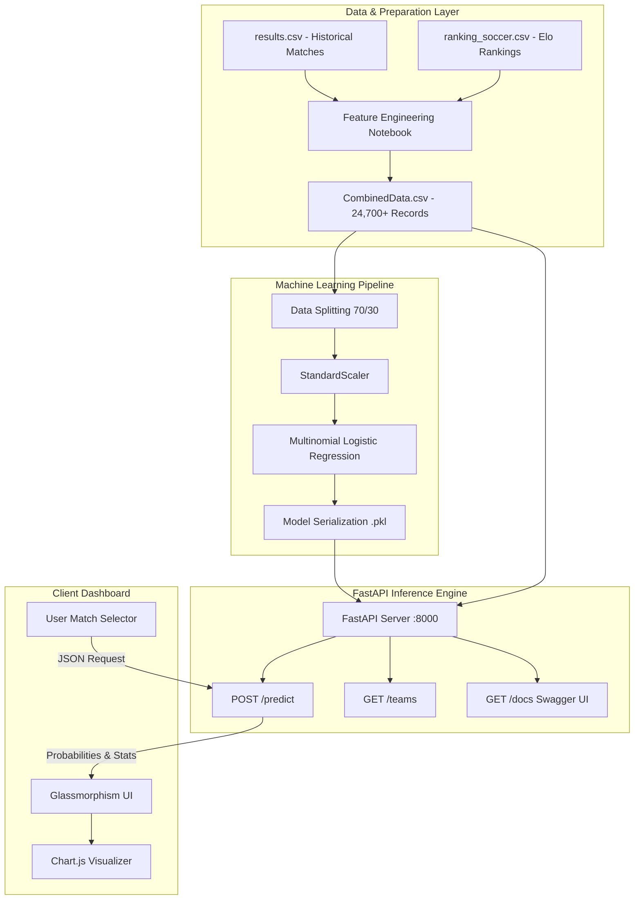

# ⚽ AI FIFA World Cup Predictor

<div align="center">

[](https://www.python.org/)
[](https://fastapi.tiangolo.com/)
[](https://scikit-learn.org/)
[](https://pandas.pydata.org/)
[](https://tailwindcss.com/)
[](https://www.chartjs.org/)
[](LICENSE)

<p align="center">
  <b>An end-to-end Machine Learning football outcome prediction system powered by dynamic Elo ratings, rolling momentum metrics, a FastAPI REST engine, and a modern glassmorphism dashboard.</b>
</p>

[Key Features](#-key-features) •
[Architecture](#-system-architecture) •
[Machine Learning](#-machine-learning--feature-engineering) •
[Requirements](#-requirements--prerequisites) •
[Quickstart](#-installation--getting-started) •
[API Reference](#-api-documentation) •
[Project Structure](#-project-structure)

</div>

---

## 📖 Overview

The **AI FIFA World Cup Predictor** is a full-stack, data-driven football analytics platform. By synthesizing over 24,000 international football matches (dating back across decades) with historical World Football Elo Ratings, the system computes probabilistic match outcomes (**Home Win**, **Draw**, or **Away Win**).

Instead of relying solely on static historical win rates, the platform dynamically factors in:
- Relative team strength through continuous Elo rating differentials.
- Short-term form momentum and weighted rolling point accumulation.
- Goal differential trends (offensive threat vs. defensive concessions).
- Contextual venue advantages (home pitch vs. neutral tournament stadiums like the FIFA World Cup).
- Match stakes (friendly friendlies vs. competitive international tournament fixtures).

---

## 🚀 Key Features

- **⚡ End-to-End Predictive Pipeline:** Automated feature extraction, standard scaling, and calibrated multi-class probability output.
- **🌐 High-Performance REST API:** Built with FastAPI, featuring async request handling, Pydantic type validation, and automatic OpenAPI (Swagger/ReDoc) documentation.
- **🎨 Glassmorphism Interactive UI:** Dark-mode dashboard crafted with Tailwind CSS and responsive glass-morphism aesthetic.
- **📊 Real-Time Visual Analytics:** Interactive outcome distribution charts and statistical breakdowns powered by Chart.js.
- **🌍 220+ National Teams Supported:** Full international roster with instant historical data lookup and head-to-head stat comparisons.
- **🏟️ Match Context Modeling:** Toggleable tournament venue conditions (neutral ground vs. home ground) and match type (competitive vs. friendly).

---

## 🏗️ System Architecture



---

## 🧠 Machine Learning & Feature Engineering

### 1. Engineered Features

The model processes 7 core statistical indicators computed from historical matches up to the fixture date:

| Feature | Type | Description | Intuition / Impact |
|---|---|---|---|
| `elo_diff` | `float` | $Elo_{home} - Elo_{away}$ | Captures baseline relative strength differential between nations. |
| `home_form` | `int` | Recent match points (Home) | Rolling points earned over recent fixtures (3 for Win, 1 for Draw). |
| `away_form` | `int` | Recent match points (Away) | Rolling points earned over recent fixtures for the away nation. |
| `home_advantage` | `binary (0/1)` | Home pitch indicator | `1` if host nation has home pitch advantage; `0` for neutral venues (e.g., World Cup). |
| `is_friendly` | `binary (0/1)` | Match competition flag | `1` for international friendlies; `0` for competitive tournaments/qualifiers. |
| `home_goal_diff_form` | `float` | Rolling goal differential (Home) | Trend of goals scored minus conceded in recent matches. |
| `away_goal_diff_form` | `float` | Rolling goal differential (Away) | Trend of goals scored minus conceded in recent matches. |

### 2. Model Performance

Trained using **Multinomial Logistic Regression** with an `lbfgs` solver and `StandardScaler` normalization over a 70/30 train-test split:

- **Overall Accuracy:** `~58%` (predicting across 3 balanced outcomes: Home Win, Draw, Away Win)
- **Target Distribution:**
  - `Home Win (2)`: ~48.4%
  - `Away Win (0)`: ~27.5%
  - `Draw (1)`: ~24.1%

```
Classification Report:
              precision    recall  f1-score   support
    Away Win       0.52      0.60      0.56      2018
        Draw       0.35      0.01      0.02      1782
    Home Win       0.61      0.86      0.72      3611
```

---

## 🛠️ Tech Stack

| Domain | Technologies |
|---|---|
| **Backend & API** | [Python 3.10+](https://www.python.org/), [FastAPI](https://fastapi.tiangolo.com/), [Uvicorn](https://www.uvicorn.org/), [Pydantic](https://docs.pydantic.dev/) |
| **Machine Learning** | [Scikit-learn](https://scikit-learn.org/), [Pandas](https://pandas.pydata.org/), [NumPy](https://numpy.org/), [Joblib](https://joblib.readthedocs.io/) |
| **Frontend UI** | [HTML5](https://developer.mozilla.org/en-US/docs/Web/HTML), [Tailwind CSS](https://tailwindcss.com/) (CDN), [JavaScript (ES6+)](https://developer.mozilla.org/en-US/docs/Web/JavaScript), [Chart.js](https://www.chartjs.org/) |
| **Data Analysis** | [Jupyter Notebook](https://jupyter.org/), [Matplotlib](https://matplotlib.org/), [Seaborn](https://seaborn.pydata.org/) |

---

## 📋 Requirements & Prerequisites

### System Requirements
- **Operating System:** Windows 10/11, macOS, or Linux
- **Python:** `Python 3.10` or higher (`Python 3.10` - `3.14` compatible)
- **Web Browser:** Any modern web browser (Google Chrome, Mozilla Firefox, Microsoft Edge, Brave, Safari)

### Python Dependencies (`requirements.txt`)

```text
# Core Backend & REST API
fastapi>=0.100.0
uvicorn[standard]>=0.22.0
pydantic>=2.0.0

# Machine Learning & Data Science
pandas>=2.0.0
numpy>=1.24.0
scikit-learn>=1.3.0
joblib>=1.3.0

# Exploratory Analysis & Jupyter Notebooks (Optional)
matplotlib>=3.7.0
seaborn>=0.12.0
notebook>=7.0.0
```

---

## ⚡ Installation & Getting Started

### 1. Clone the Repository

```bash
git clone https://github.com/your-username/AI-FIFA-World-Cup-Predictor.git
cd AI-FIFA-World-Cup-Predictor
```

### 2. Set Up a Virtual Environment

It is recommended to run the project in an isolated virtual environment:

#### Windows (PowerShell):
```powershell
python -m venv venv
.\venv\Scripts\Activate.ps1
```

#### Windows (Command Prompt):
```cmd
python -m venv venv
venv\Scripts\activate.bat
```

#### macOS / Linux:
```bash
python3 -m venv venv
source venv/bin/activate
```

### 3. Install Dependencies

Install all required packages with a single command:

```bash
pip install -r requirements.txt
```

---

## 🏃 Running the Application

### Step 1: Train the Model (Optional / Pre-trained Included)

The repository includes preprocessed data. You can train or retrain the model at any time:

```bash
python src/main.py
```
This trains the Logistic Regression classifier and outputs:
- `src/football_model.pkl`
- `src/scaler.pkl`

### Step 2: Start the FastAPI Backend Server

Run Uvicorn from the project root or from inside `src/`:

```bash
# From project root:
uvicorn src.app:app --reload --host 127.0.0.1 --port 8000
```
*Or:*
```bash
cd src
uvicorn app:app --reload --port 8000
```

The API will now be live at: `http://127.0.0.1:8000`

### Step 3: Launch the Frontend Dashboard

Simply open `frontend/index.html` in your browser:

- **Option A (Direct):** Double-click `frontend/index.html` or drag it into your web browser.
- **Option B (Python Local Server):**
  ```bash
  # In a new terminal window:
  cd frontend
  python -m http.server 3000
  ```
  Then navigate to `http://localhost:3000` in your browser.
- **Option C (VS Code):** Right-click `frontend/index.html` and choose **"Open with Live Server"**.

---

## 📡 API Documentation

FastAPI provides automated, interactive documentation:
- **Swagger UI:** [http://127.0.0.1:8000/docs](http://127.0.0.1:8000/docs)
- **ReDoc:** [http://127.0.0.1:8000/redoc](http://127.0.0.1:8000/redoc)

### Endpoints Overview

| Method | Endpoint | Description |
|---|---|---|
| `GET` | `/` | API status and team catalog count |
| `GET` | `/teams` | Returns a list of all 220+ available national teams |
| `POST` | `/predict` | Computes match probabilities given two teams and venue settings |

---

### Prediction Endpoint: `POST /predict`

#### Request Payload
```json
{
  "home_team": "Brazil",
  "away_team": "Argentina",
  "neutral": true,
  "friendly": false
}
```

#### Example cURL Command
```bash
curl -X POST "http://127.0.0.1:8000/predict" \
     -H "Content-Type: application/json" \
     -d '{
       "home_team": "Brazil",
       "away_team": "Argentina",
       "neutral": true,
       "friendly": false
     }'
```

#### Successful Response (`200 OK`)
```json
{
  "home_team": "Brazil",
  "away_team": "Argentina",
  "features": {
    "elo_diff": -126.0,
    "home_form": 7,
    "away_form": 12,
    "home_goal_diff_form": 1.0,
    "away_goal_diff_form": 1.8
  },
  "probabilities": {
    "away_win": 35.17,
    "draw": 30.61,
    "home_win": 34.22
  }
}
```

---

## 📂 Project Structure

```text
AI-FIFA-WORLD-CUP-PREDICTOR/
│
├── data/                                 # Datasets and historical records
│   ├── CombinedData.csv                  # Merged dataset with engineered features (24,700+ rows)
│   ├── ranking_soccer_1901-2023.csv      # Historical international Elo rankings (1901-2023)
│   └── results.csv                       # Historical international football match results
│
├── frontend/                             # User interface
│   └── index.html                        # Glassmorphism dark-theme web dashboard (Tailwind + Chart.js)
│
├── notebooks/                            # Exploratory Data Analysis & experiments
│   └── feature_engineering.ipynb         # Data cleaning, feature creation & visualization
│
├── src/                                  # Application source code
│   ├── app.py                            # FastAPI REST application & inference handlers
│   ├── main.py                           # Model training, scaling, & evaluation script
│   ├── CombinedData.csv                  # Local copy for portable execution
│   ├── football_model.pkl                # Trained Scikit-Learn Logistic Regression model
│   └── scaler.pkl                        # Trained StandardScaler instance
│
├── .gitignore                            # Git ignore rules (pycache, venvs, IDE settings)
├── LICENSE                               # MIT License
├── README.md                             # Comprehensive project documentation
└── requirements.txt                      # Project dependency specifications
```

---

## 📊 Dataset Attribution

1. **International Football Results (1872–Present):** Over 40,000 international fixtures containing date, tournament, neutral venue flag, and final scores.
2. **World Soccer Elo Ratings (1901–2023):** Continuous ratings tracking national team quality over time.
3. **Combined Data Pipeline:** Synthesized in `notebooks/feature_engineering.ipynb` to construct continuous rolling statistics, goal averages, and Elo differentials.

---

## 🗺️ Roadmap & Future Enhancements

- [ ] **Tournament Bracket Simulation:** Monte Carlo simulation engine to simulate full FIFA World Cup group stages and knockout brackets.
- [ ] **Ensemble Modeling:** Experiment with `XGBoost`, `LightGBM`, and `CatBoost` for enhanced non-linear pattern recognition.
- [ ] **Player Squad Attributes:** Incorporate average FIFA squad ratings, injuries, and lineup adjustments.
- [ ] **Live Odds Comparison:** Benchmark model output against historical bookmaker odds and market implied probabilities.

---

## 🤝 Contributing

Contributions are welcome! Please follow these steps:

1. **Fork the repository**
2. **Create a feature branch:**
   ```bash
   git checkout -b feature/AmazingFeature
   ```
3. **Commit your changes:**
   ```bash
   git commit -m "Add AmazingFeature"
   ```
4. **Push to your branch:**
   ```bash
   git push origin feature/AmazingFeature
   ```
5. **Open a Pull Request**

---

## 📄 License

Distributed under the **MIT License**. See [`LICENSE`](LICENSE) for more information.

---

<div align="center">
  <b>Developed for Football & Machine Learning Enthusiasts ⚽🤖</b>
</div>
